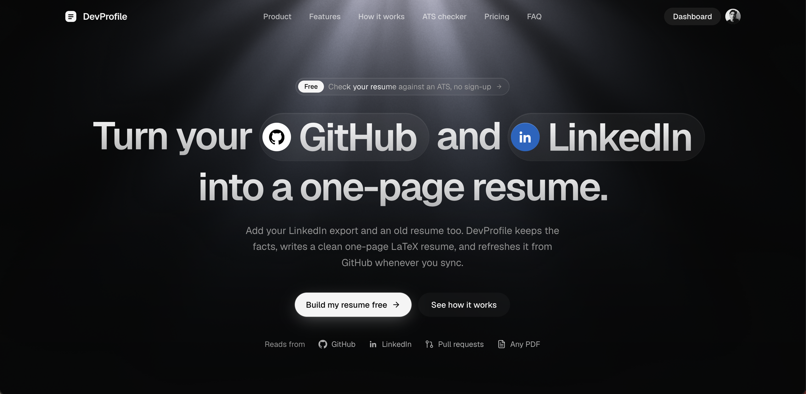
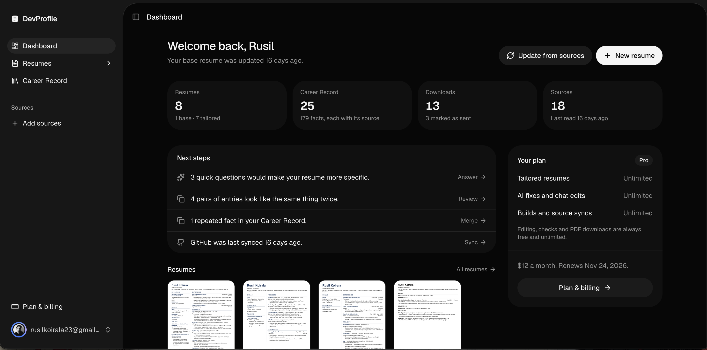
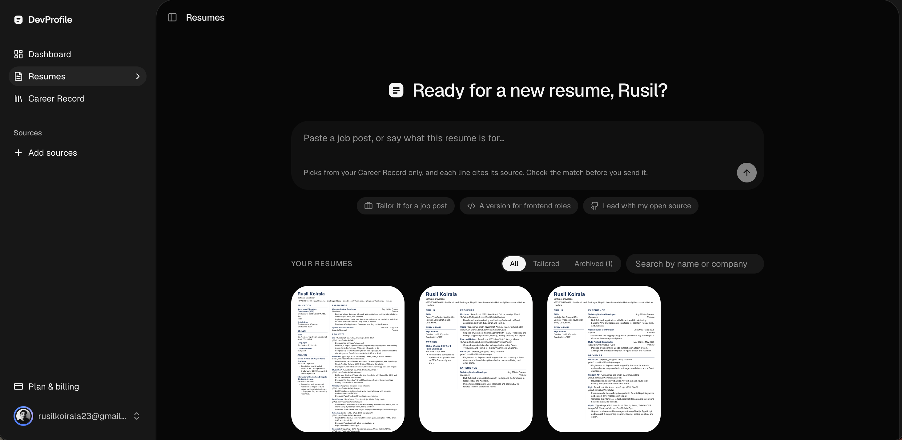

# DevProfilePro

So we all get that problem when we have worked alot and the resume isn't updated. What if resume auto updates with your projects and work USING AI. yess that what devprofilepro is

## What it does

It brings data from public GitHub repos and merged pull requests or your old resume and builds a BIGG career record 

THEN comes AI it writes your resume according to your prompt for a job or just general

a one-page PDF is made which u can download as pdf or LaTeX source.

# What I learned

This should be at a blog but sorry I really wanted to share my learning through readme :) . I will tell everyone to make this backend ones. I really understood alot of things in backend through this project. I understood alot about making schema's and producing relation between them, the way controllers and utils can be used together. 

# AI USAGE NOTE

I used Ai help for some parts of the project like improving code structure, debugging complex issues (THOSE TYPO ERROR I CANT FIND WITH MY STUPID EYES ;-; ) and generating some frontend ui code (cuz i suck in ui part).

I will say most part of main idea, app flow and overall project structure were build by me. The core backend logic(although i got into some bugs :D).

# Thank you so much for reading this readme, I really appreciate it :D